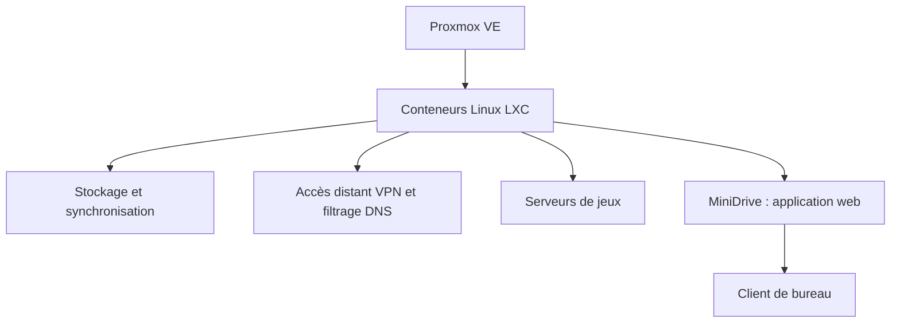

# MiniNAS

**Infrastructure personnelle auto-hébergée avec Proxmox VE**

MiniNAS est un laboratoire personnel conçu pour regrouper des services de stockage, de synchronisation, d'accès distant et de jeu sur un serveur Proxmox VE. Le projet couvre la conception de l'architecture, le déploiement de services Linux isolés, leur administration, leur sécurisation et la gestion des sauvegardes.

## Objectifs

- Héberger plusieurs services sur une seule machine tout en les séparant par rôle.
- Accéder aux ressources à distance à travers un VPN.
- Administrer les services Linux, le stockage et les sauvegardes.
- Appliquer des règles de filtrage et le principe du moindre privilège.
- Développer une application personnelle de partage de fichiers, MiniDrive.

## Architecture générale

Les services sont regroupés par fonction dans des conteneurs Linux. Cette organisation facilite leur administration et limite les dépendances entre les services. Le schéma est volontairement simplifié et ne représente ni le plan réseau réel ni les règles d'accès.

## Services et technologies

- **Virtualisation et conteneurs :** Proxmox VE et LXC.
- **Stockage et synchronisation :** Samba et Syncthing.
- **Accès distant et filtrage DNS :** WireGuard et Pi-hole.
- **Jeux :** serveurs Minecraft Forge et Project Zomboid.
- **MiniDrive :** application web personnelle avec un serveur Go, une base SQLite et une interface React / TypeScript / Tailwind CSS. Un client de bureau est développé avec Tauri et Rust.
- **Sauvegardes :** sauvegardes de conteneurs et copie chiffrée vers un stockage distant.

## MiniDrive

MiniDrive est une application personnelle de gestion et de partage de fichiers. Le projet comprend une interface web, une gestion des comptes et des partages, ainsi qu'un espace de supervision. Le client de bureau vise à faciliter l'accès depuis plusieurs systèmes d'exploitation.

## Administration et sécurité

Le projet met en pratique la séparation des services, le filtrage réseau, l'utilisation de comptes dédiés pour certains services, l'accès distant par VPN et la sauvegarde chiffrée. Ces mesures réduisent les risques mais ne remplacent pas la mise à jour régulière, la vérification des sauvegardes et une revue de sécurité continue.

Cette présentation ne publie volontairement ni adresses réseau, ni noms de comptes ou de machines, ni ports exposés, ni chemins internes, ni fichiers de configuration. Les procédures d'installation propres au réseau personnel restent privées.

## Compétences mises en pratique

Administration Linux, Proxmox VE, conteneurs LXC, réseaux et pare-feu, services de fichiers, VPN, stockage, sauvegarde et restauration, diagnostic système, ainsi que développement web et applicatif.

## Périmètre

MiniNAS est un projet personnel et un laboratoire d'apprentissage. La configuration décrite ici est une présentation de l'architecture générale ; elle ne constitue pas un guide d'installation directement reproductible. Les détails de déploiement dépendent du matériel et de l'environnement de chaque personne.
